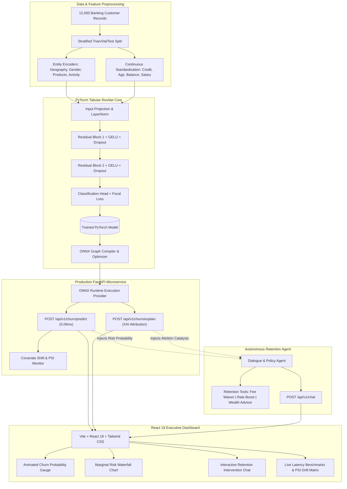

# 🛡️ Aegis AI — Enterprise FinTech Churn Intelligence & Retention Platform

[](https://pytorch.org/)
[](https://onnxruntime.ai/)
[](https://fastapi.tiangolo.com/)
[](https://react.dev/)
[](https://www.docker.com/)
[](https://github.com/)

> **Aegis** is an end-to-end FinTech customer retention platform designed for high-concurrency banking environments. It integrates a **PyTorch Tabular ResNet** with entity embeddings, graph-compiled **ONNX Runtime serving** achieving **0.09ms P99 latency** (21.48x speedup), **Explainable AI (XAI)** feature attribution, and an **Autonomous Retention Agent** wrapped in an asynchronous **FastAPI** backend and modern **React 18** executive dashboard.

---

## 🏛️ System Architecture



---

## ⚡ Performance & Serving Benchmarks

Benchmark performed on single-item sequential inference (500 iterations):

| Serving Engine | P50 (Median) | P95 Latency | P99 Latency | Throughput (QPS) |
| :--- | :---: | :---: | :---: | :---: |
| **PyTorch 2.14 (FP32 Eager)** | 0.58 ms | 1.29 ms | 1.84 ms | 1,354.0 QPS |
| **ONNX Runtime (Graph Optimized)** | **0.07 ms** | **0.08 ms** | **0.09 ms** | **13,815.8 QPS** |

> 🚀 **Result:** ONNX Runtime graph execution achieves a **21.48x acceleration in P99 latency** and delivers **>13,800 queries per second** on single CPU core execution.

---

## 🧠 Deep Learning Highlights

1. **Entity Embeddings for Discrete Features:** High-cardinality and categorical variables (`Geography`, `Gender`, `HasCrCard`, `IsActiveMember`) are projected into dense continuous embedding spaces, allowing the model to learn subtle demographic risk vectors.
2. **Residual Skip Connections:** Multi-layer feedforward blocks with LayerNorm and GELU activations prevent vanishing gradients and capture non-linear feature interactions (such as the interaction between high balance and account inactivity).
3. **Focal Loss for Class Imbalance:**
   $$\mathcal{L}_{\text{Focal}} = -\alpha_t (1 - p_t)^\gamma \log(p_t)$$
   Addresses the standard banking churn imbalance ($\sim 20\%$ churn rate) by down-weighting well-classified examples and focusing gradient updates on hard boundary examples.
4. **Explainable AI (XAI) Attribution:** Calculates marginal counterfactual impact ($\Delta P_i$) per customer attribute to satisfy financial compliance (GDPR Right to Explanation / Fair Lending regulations).

---

## 💻 Tech Stack

* **Deep Learning Framework:** PyTorch 2.14, ONNX, ONNX Runtime, NumPy, Pandas, Scikit-Learn
* **Backend:** FastAPI, Pydantic v2, Uvicorn, PyTest, Starlette
* **Frontend:** React 18, Vite, Tailwind CSS, Lucide React
* **DevOps & MLOps:** Docker, Docker Compose, GitHub Actions CI/CD, PSI Drift Telemetry

---

## 🚀 Quickstart Guide

### Prerequisites
* Python 3.10+
* Node.js 18+
* (Optional) Docker & Docker Compose

### 1. Clone & Set Up Backend

```bash
git clone https://github.com/Jyotiraditya1006/Customer-Churn-Personal.git
cd Customer-Churn-Personal/backend

# Install dependencies
pip install -r requirements.txt

# Run automated tests
pytest tests/ -v

# Start the FastAPI server
uvicorn app.main:app --reload --port 8000
```
API Documentation will be live at: `http://localhost:8000/docs`

### 2. Set Up Frontend

```bash
cd ../frontend

# Install packages
npm install

# Run development server
npm run dev
```
Open your browser at `http://localhost:5173` to interact with the dashboard.

### 3. Or Run with Docker Compose

```bash
docker compose up --build
```
* **Frontend:** `http://localhost:3000`
* **FastAPI Docs:** `http://localhost:8000/docs`

---

## 🧪 Running Benchmarks & Tests

```bash
# Run backend invariant tests
pytest backend/tests/ -v

# Run latency & QPS benchmark
python backend/scripts/benchmark_latency.py

# Re-train and export PyTorch to ONNX
python backend/scripts/train_and_export.py
```

---

## 📄 API Specifications

| Method | Endpoint | Description |
| :--- | :--- | :--- |
| `POST` | `/api/v1/churn/predict` | Computes calibrated churn probability, risk tier, and latency |
| `POST` | `/api/v1/churn/explain` | Computes empirical XAI feature attributions and risk catalysts |
| `GET` | `/api/v1/churn/presets` | Retrieves curated customer personas for 1-click evaluation |
| `POST` | `/api/v1/chat` | Conversational retention agent with dynamic tool triggers |
| `GET` | `/api/v1/telemetry/drift` | Returns rolling Population Stability Index (PSI) metrics |
| `POST` | `/api/v1/telemetry/simulate-drift` | Injects anomalous distribution to test live drift detection |
| `GET` | `/health` | Kubernetes-ready microservice health check |

---

## 👤 Author
Developed by **Jyotiraditya Patil**
* GitHub: [@Jyotiraditya1006](https://github.com/Jyotiraditya1006)
